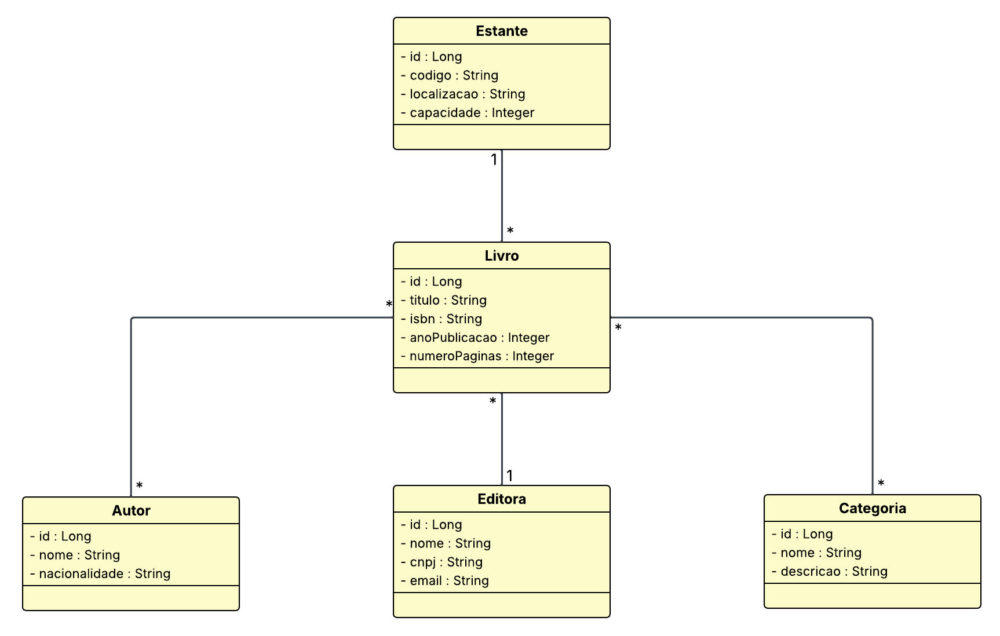

<div align="center">

# 📚 DevLib

### API REST para gerenciamento de bibliotecas


</div>

API REST para gerenciamento de uma biblioteca, desenvolvida com Spring Boot. O projeto permite cadastrar e administrar livros, autores, categorias, editoras e estantes, além de associar livros a autores e categorias.

> Projeto desenvolvido como uma aplicação backend para estudo e prática de APIs REST, persistência com JPA e evolução de banco de dados com Flyway.

## 📑 Índice

- [Funcionalidades](#funcionalidades)
- [Tecnologias](#tecnologias)
- [Arquitetura](#arquitetura)
- [Pré-requisitos](#pré-requisitos)
- [Configuração do banco de dados](#configuração-do-banco-de-dados)
- [Como executar](#como-executar)
- [Testando com o Postman](#testando-com-o-postman)
- [Executando os testes](#executando-os-testes)
- [API REST](#api-rest)
- [Respostas de erro](#respostas-de-erro)
- [Perfis de execução](#perfis-de-execução)

## Funcionalidades

### 📖 Gerenciamento do acervo

- **Livros:** cadastro, consulta por ID, listagem, atualização e exclusão;
- **Autores:** cadastro, consulta, atualização, listagem e exclusão;
- **Categorias:** organização dos livros por título e descrição;
- **Editoras:** cadastro de nome, CNPJ e e-mail;
- **Estantes:** controle de código, localização e capacidade de armazenamento.

### 🔗 Relacionamentos

- associação de um livro a uma **editora** e a uma **estante**;
- associação de múltiplos **autores** a um livro;
- associação de múltiplas **categorias** a um livro;
- inclusão e remoção individual de autores e categorias por endpoint;
- prevenção de associações duplicadas e tratamento de relacionamentos inexistentes;
- proteção contra exclusão de recursos que ainda possuem dependências.

### ✅ Validação e regras de negócio

- validação dos dados de entrada com Bean Validation antes do processamento;
- verificação da existência de editora, estante, autores, categorias e livros referenciados;
- validação dos IDs informados no cadastro de livros, evitando salvar relacionamentos inexistentes;
- bloqueio de associações duplicadas e de remoções de associações que não existem;
- prevenção da exclusão de autores, categorias, editoras ou estantes vinculados a livros;
- tratamento global de exceções com respostas padronizadas para `400`, `404` e `409`.

### 🛠️ Persistência e qualidade

- arquitetura em camadas com controllers, services, repositories, entidades e DTOs;
- separação entre DTOs de inserção, atualização e resposta;
- persistência relacional com Spring Data JPA e Hibernate;
- migração inicial do banco versionada com Flyway;
- PostgreSQL no ambiente de desenvolvimento;
- H2 em memória para testes automatizados;
- testes de controllers e services, com **138 testes executados com sucesso**;
- console H2 disponível no perfil de testes para inspeção do banco durante o desenvolvimento.

## Tecnologias

- Java 17;
- Spring Boot 4.1.0;
- Spring Web MVC;
- Spring Data JPA / Hibernate;
- Bean Validation;
- PostgreSQL;
- H2 Database;
- Flyway;
- Maven Wrapper;
- JUnit e Spring Boot Test.

## Arquitetura

O código está organizado em camadas:

```text
src/main/java/com/devlib/devlib/
├── controller/       # Endpoints HTTP da API
├── services/         # Regras de negócio
├── repositories/     # Acesso aos dados com Spring Data JPA
├── entites/          # Entidades persistidas no banco
├── dto/              # Objetos de entrada, atualização e resposta
└── services/exceptions/
    ├── base/         # Exceções base
    └── handler/      # Tratamento global de erros
```

O modelo possui as seguintes relações:

- um livro pertence a uma editora;
- um livro ocupa uma estante;
- um livro pode possuir vários autores;
- um livro pode possuir várias categorias;
- as relações livro–autor e livro–categoria são armazenadas em tabelas de associação.



## Pré-requisitos

- JDK 17 ou superior;
- PostgreSQL instalado e em execução para utilizar o perfil `dev`;
- Git, caso o projeto seja clonado do GitHub.

Para testar os endpoints de forma prática, recomenda-se instalar o [Postman](https://www.postman.com/downloads/), ferramenta utilizada durante o desenvolvimento deste projeto para enviar requisições HTTP e consultar as respostas da API.

Confira a versão do Java e do Maven Wrapper:

```bash
java -version
./mvnw -version
```

No Windows, use `./mvnw.cmd` no lugar de `./mvnw` (no PowerShell, o prefixo `./` é necessário).

## Configuração do banco de dados

O perfil padrão da aplicação é o `dev`, definido em `src/main/resources/application.properties`. Ele espera encontrar um banco PostgreSQL com as seguintes configurações:

| Propriedade | Valor atual |
|---|---|
| Host | `localhost` |
| Porta | `5432` |
| Banco | `DevLib` |
| Usuário | `postgres` |
| Senha | `123` |

Crie o banco antes de iniciar a aplicação:

```sql
CREATE DATABASE "DevLib";
```

Em seguida, ajuste `src/main/resources/application-dev.properties` conforme o seu ambiente. A aplicação utiliza `spring.jpa.hibernate.ddl-auto=validate`, portanto o esquema é criado pela migração Flyway `V1__cria_tabelas.sql` e validado pelo Hibernate.

### Atenção sobre credenciais

As credenciais exibidas acima são as configurações atuais do projeto e servem apenas para ambiente local. Não utilize senhas reais versionadas no GitHub. Para publicar ou executar em outros ambientes, substitua-as por variáveis de ambiente ou por um arquivo de configuração externo.

## Como executar

Clone o repositório e entre na pasta do projeto:

```bash
git clone <URL_DO_SEU_REPOSITORIO>
cd DevLiv-main
```

Execute a aplicação com o perfil padrão:

```bash
./mvnw spring-boot:run
```

No Windows:

```bat
./mvnw.cmd spring-boot:run
```

Por padrão, a API ficará disponível em:

```text
http://localhost:8080
```

| Sistema | Comando |
|---|---|
| Linux/macOS | `./mvnw spring-boot:run` |
| Windows PowerShell | `./mvnw.cmd spring-boot:run` |
| Windows CMD | `mvnw.cmd spring-boot:run` |

## Testando com o Postman

Depois de iniciar a aplicação, abra o Postman e crie requisições para a URL base `http://localhost:8080`. Selecione `Body > raw > JSON` nas requisições `POST` e `PUT` e informe o header:

```text
Content-Type: application/json
```

Uma sequência sugerida para testar o projeto é:

1. cadastrar uma editora em `POST /editoras`;
2. cadastrar uma estante em `POST /estantes`;
3. cadastrar um autor em `POST /autores`;
4. cadastrar uma categoria em `POST /categorias`;
5. cadastrar um livro em `POST /livros`, informando os IDs criados anteriormente;
6. consultar, atualizar, associar ou remover os recursos usando os demais endpoints documentados abaixo.

Exemplo de URL no Postman:

```text
GET http://localhost:8080/livros
```

O Postman pode ser baixado gratuitamente pelo site oficial: [postman.com/downloads](https://www.postman.com/downloads/).

## Executando os testes

Os testes utilizam o perfil `test`, H2 em memória e `create-drop`, não exigindo um servidor PostgreSQL:

```bash
./mvnw test "-Dspring.profiles.active=test"
```

No Windows:

```bat
./mvnw.cmd test "-Dspring.profiles.active=test"
```

Também é possível gerar o pacote da aplicação:

```bash
./mvnw clean package
```

O resultado será gerado em `target/`.

## API REST

Os endpoints de criação e atualização (`POST` e `PUT`) recebem JSON e os endpoints que retornam recursos respondem em JSON. As operações de exclusão (`DELETE`) retornam `204 No Content` quando concluídas. Os identificadores são numéricos (`Long`).

### Livros

| Método | Endpoint | Descrição |
|---|---|---|
| `GET` | `/livros` | Lista todos os livros |
| `GET` | `/livros/{id}` | Busca um livro por ID |
| `POST` | `/livros` | Cadastra um livro |
| `PUT` | `/livros/{id}` | Atualiza um livro |
| `DELETE` | `/livros/{id}` | Remove um livro |
| `POST` | `/livros/{livroId}/autores/{autorId}` | Associa um autor ao livro |
| `DELETE` | `/livros/{livroId}/autores/{autorId}` | Remove um autor do livro |
| `POST` | `/livros/{livroId}/categorias/{categoriaId}` | Associa uma categoria ao livro |
| `DELETE` | `/livros/{livroId}/categorias/{categoriaId}` | Remove uma categoria do livro |

Exemplo de cadastro de livro:

```json
{
  "titulo": "O Hobbit",
  "isbn": "978-0007525508",
  "anoPublicacao": 1937,
  "numeroPaginas": 310,
  "editoraId": 1,
  "estanteId": 1,
  "autoresId": [1],
  "categoriasId": [1]
}
```

O cadastro de livro exige pelo menos um autor e uma categoria, além de uma editora e uma estante existentes.

### Autores

| Método | Endpoint | Descrição |
|---|---|---|
| `GET` | `/autores` | Lista todos os autores |
| `GET` | `/autores/{id}` | Busca um autor por ID |
| `POST` | `/autores` | Cadastra um autor |
| `PUT` | `/autores/{id}` | Atualiza um autor |
| `DELETE` | `/autores/{id}` | Remove um autor |

```json
{
  "nome": "J. R. R. Tolkien",
  "nacionalidade": "Britânica"
}
```

### Categorias

| Método | Endpoint | Descrição |
|---|---|---|
| `GET` | `/categorias` | Lista todas as categorias |
| `GET` | `/categorias/{id}` | Busca uma categoria por ID |
| `POST` | `/categorias` | Cadastra uma categoria |
| `PUT` | `/categorias/{id}` | Atualiza uma categoria |
| `DELETE` | `/categorias/{id}` | Remove uma categoria |

```json
{
  "titulo": "Fantasia",
  "descricao": "Obras de fantasia e ficção fantástica"
}
```

### Editoras

| Método | Endpoint | Descrição |
|---|---|---|
| `GET` | `/editoras` | Lista todas as editoras |
| `GET` | `/editoras/{id}` | Busca uma editora por ID |
| `POST` | `/editoras` | Cadastra uma editora |
| `PUT` | `/editoras/{id}` | Atualiza uma editora |
| `DELETE` | `/editoras/{id}` | Remove uma editora |

```json
{
  "nome": "HarperCollins",
  "cnpj": "12.345.678/0001-90",
  "email": "contato@exemplo.com"
}
```

### Estantes

| Método | Endpoint | Descrição |
|---|---|---|
| `GET` | `/estantes` | Lista todas as estantes |
| `GET` | `/estantes/{id}` | Busca uma estante por ID |
| `POST` | `/estantes` | Cadastra uma estante |
| `PUT` | `/estantes/{id}` | Atualiza uma estante |
| `DELETE` | `/estantes/{id}` | Remove uma estante |

```json
{
  "codigo": "E-01",
  "localizacao": "Sala principal",
  "capacidade": 50
}
```

## Respostas de erro

O tratamento global de exceções retorna um objeto com data, status HTTP, mensagem e caminho da requisição. Os principais status são:

| Status | Situação |
|---|---|
| `400 Bad Request` | Dados inválidos ou campos obrigatórios ausentes |
| `404 Not Found` | Recurso ou relacionamento não encontrado |
| `409 Conflict` | Tentativa de remover recurso com dependências ou conflito de associação |

Exemplo de resposta:

```json
{
  "timestamp": "18/09/2026 19:30:00",
  "status": 404,
  "message": "Autor não encontrado",
  "path": "/autores/99"
}
```

## Perfis de execução

- `dev`: PostgreSQL local, `ddl-auto=validate` e SQL habilitado;
- `test`: H2 em memória, console H2 habilitado e banco recriado durante os testes.

Para iniciar explicitamente com o perfil de testes:

```bash
./mvnw spring-boot:run "-Dspring-boot.run.profiles=test"
```

Com o perfil `test`, o console H2 fica disponível em `http://localhost:8080/h2-console`, usando:

```text
JDBC URL: jdbc:h2:mem:testdb
User: postgres
Password: 123
```
